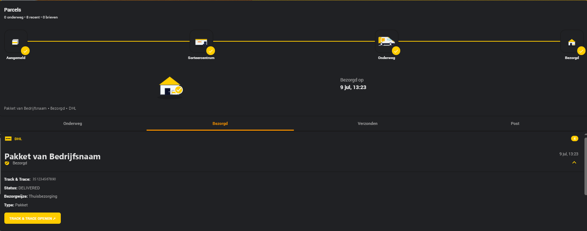
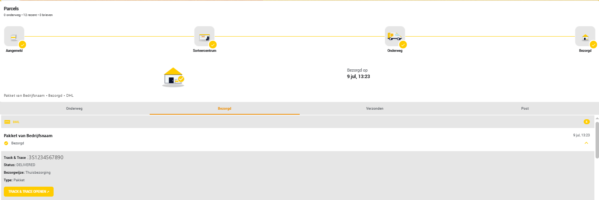
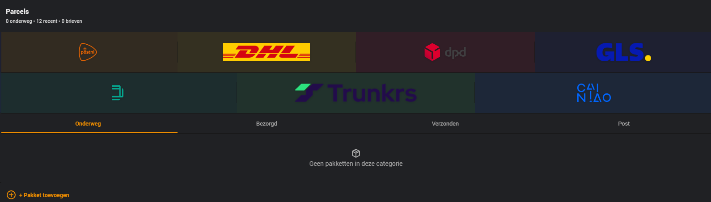
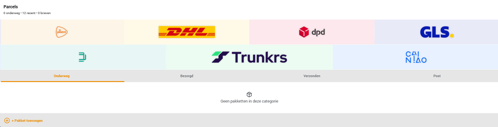
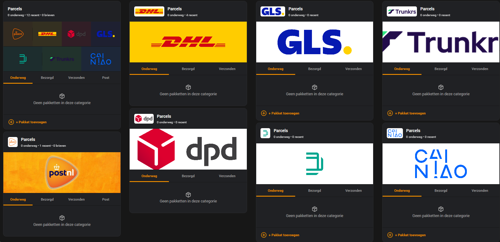
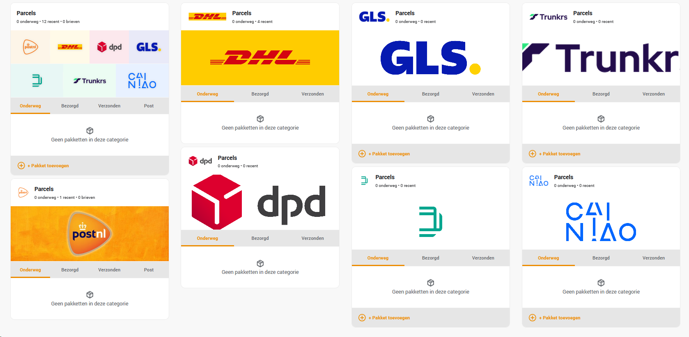
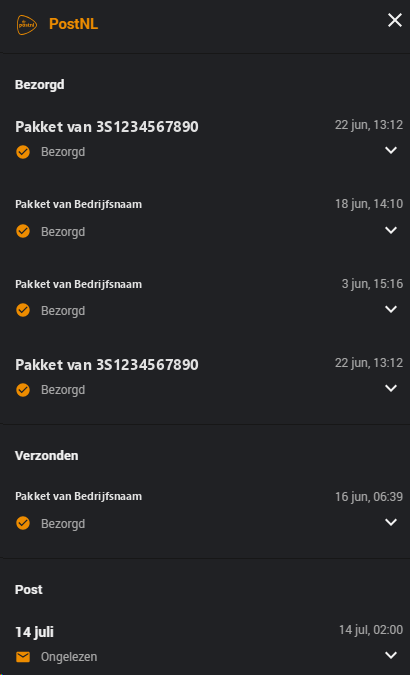
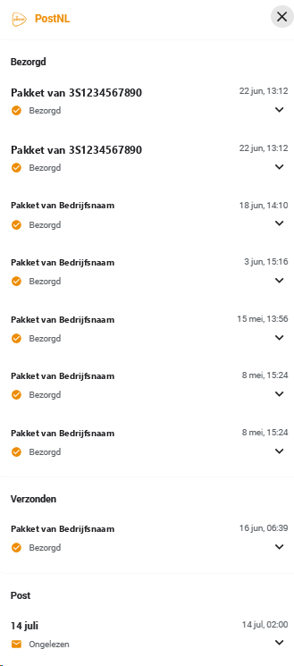
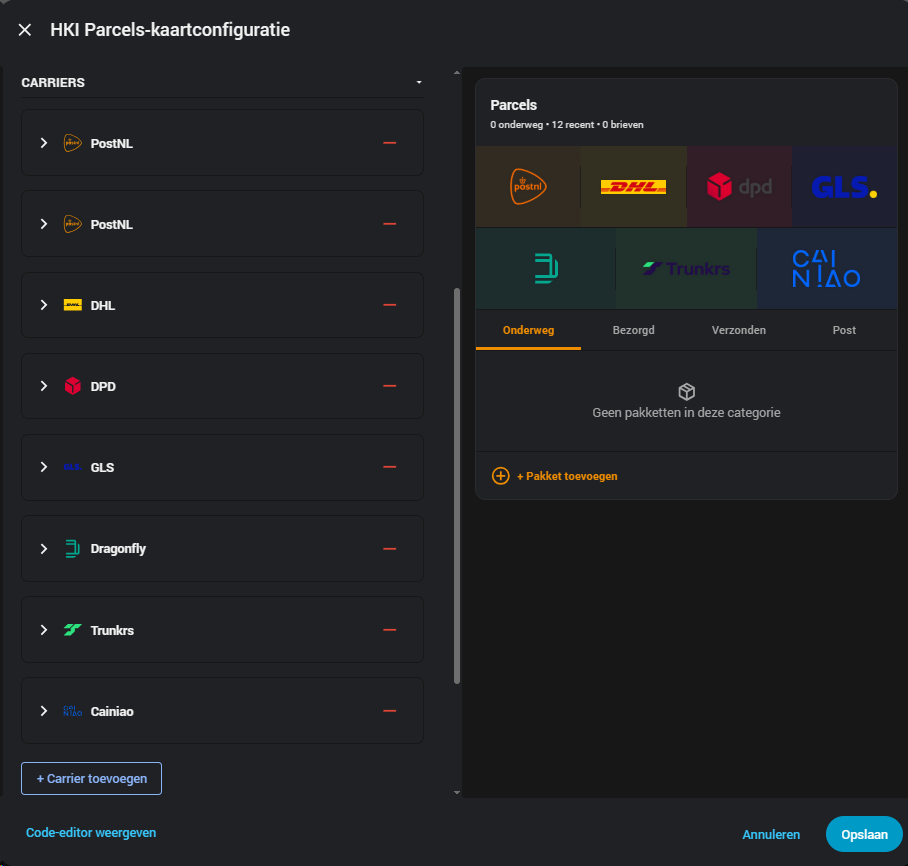

# Screenshots

## Dashboard — parcel detail

The delivery tracker and expanded parcel detail panel (barcode, status, delivery type, tracking link).
The screenshots below show an earlier beta. The current tracker uses shared SVG scenes for
every carrier, with four steps for home delivery and five when the parcel goes via a pickup point.

---

## Combo banner — multiple carriers

When two or more carriers are configured, the Studio banner shows just those carriers
in equal-sized tiles, with up to four columns and a centred final row. Logo sizes follow
offline content measurements; square integration icons have rounded corners. Tiles use
the active Home Assistant card colour, including a dark background in dark mode. Dark
wordmarks keep their original colours with a subtle light edge for readability. Existing
single-carrier banners and custom placeholder images remain available.

The screenshots below predate Studio and show the earlier combo-banner layout.

Full dashboard with every carrier's own tile alongside the combo banner:

---

## Carrier overview popup

Click a carrier's logo in the combo banner to see every parcel and letter for that carrier — grouped by section (In Transit / Delivered / Sent / Post) — in one popup. Clicking an item expands its details in place.

---

## Visual editor

Full carrier list and live preview, side by side — no YAML required.

