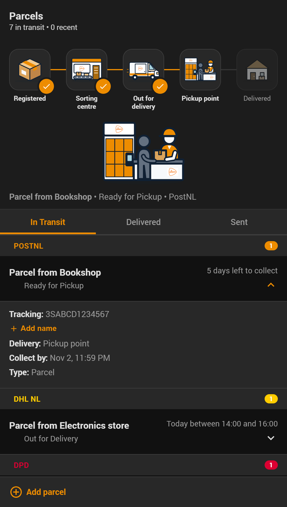
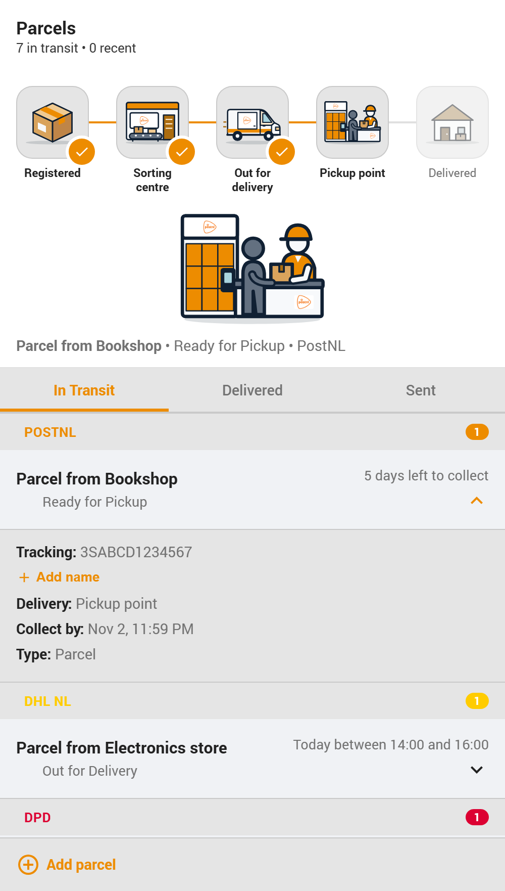
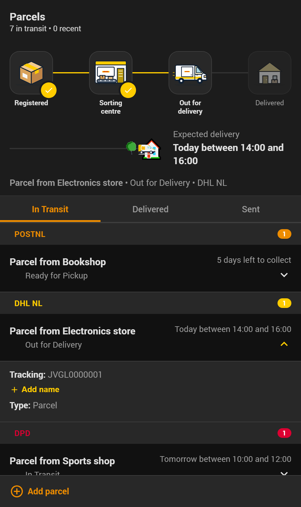
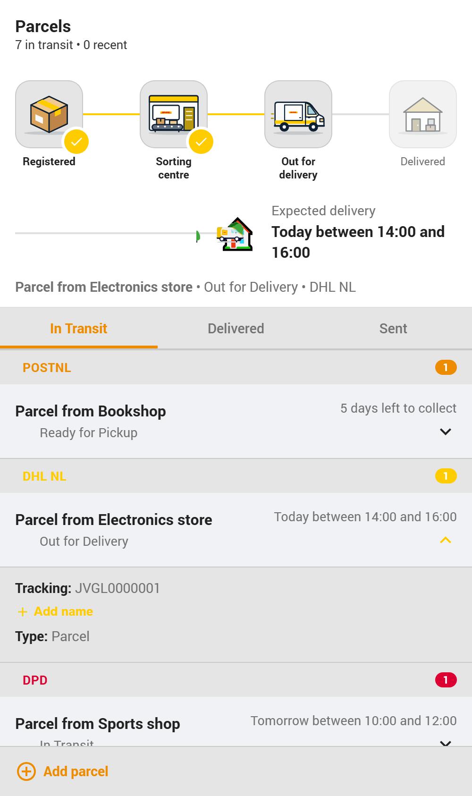
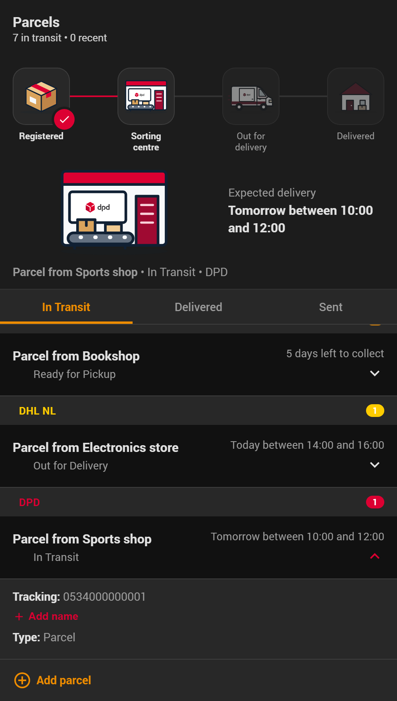
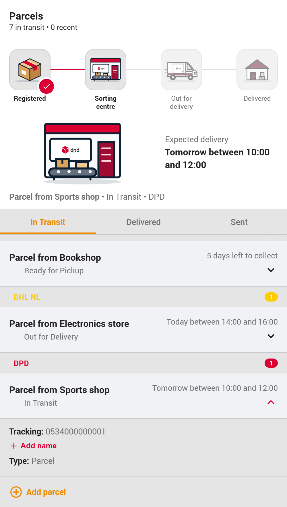
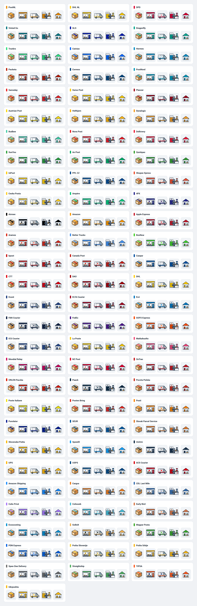
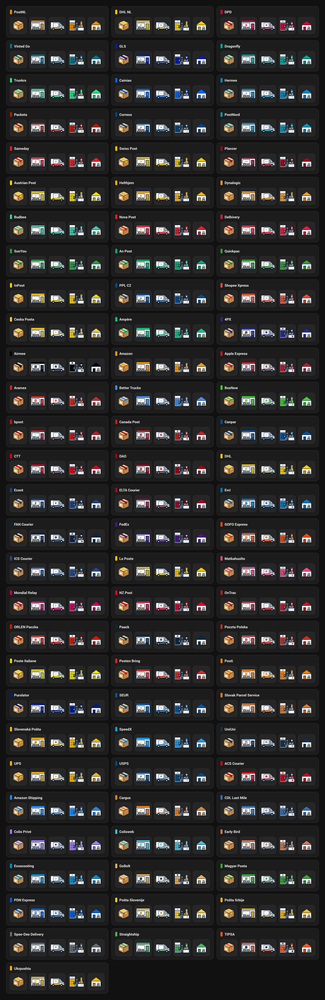
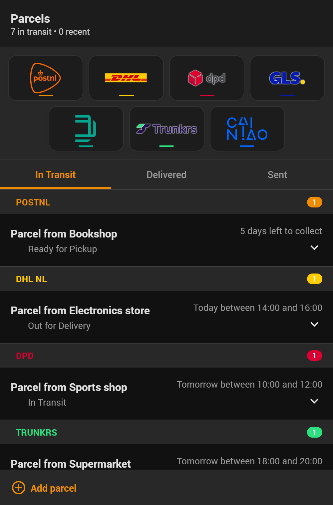
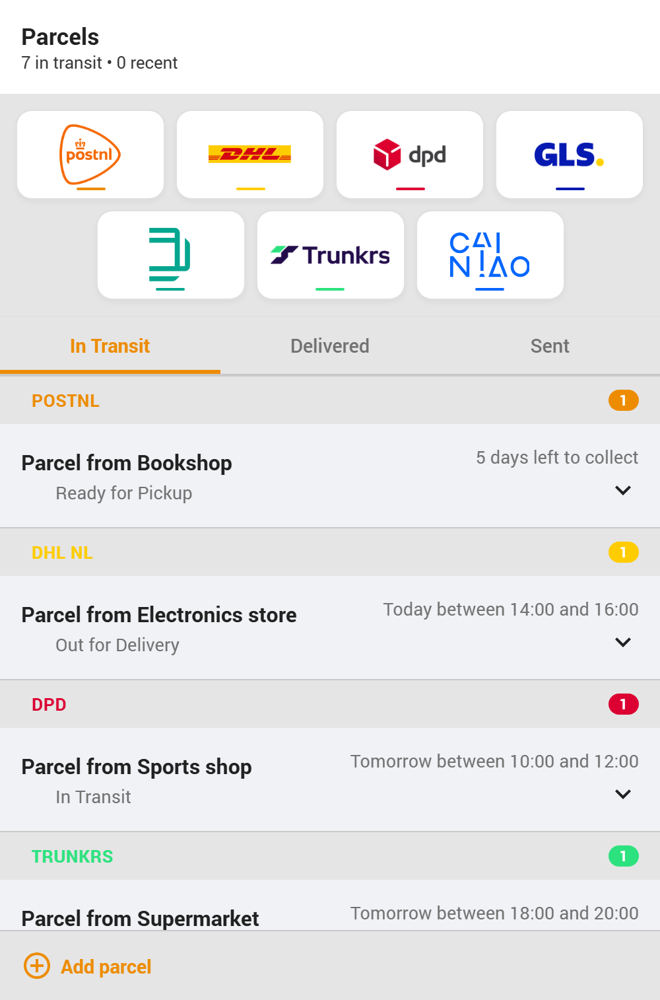

# Screenshots

## Dashboard — parcel detail

The delivery tracker and expanded parcel detail panel (tracking number, delivery type, collection
deadline). Every carrier gets the same illustrated scenes in its own colour: four steps for home
delivery, five when the parcel goes via a pickup point. The large scene shows where the parcel is now.

---

## Delivery scenes — all 85 carriers

The five scenes (Registered · Sorting centre · Out for delivery · Pickup point · Delivered) for
every supported carrier, in its configured colour and with its logo. Logos come from
[custom-brand-icons](https://github.com/elax46/custom-brand-icons) when it is installed, otherwise
from the carrier's own artwork.

=== "Light theme"

    

=== "Dark theme"

    

---

## Combo banner — multiple carriers

When two or more carriers are configured, the Studio banner shows just those carriers
in equal-sized tiles, with up to four columns and a centred final row. Logo sizes follow
offline content measurements; square integration icons have rounded corners. Tiles use
the active Home Assistant card colour, including a dark background in dark mode. Dark
wordmarks keep their original colours with a subtle light edge for readability. Existing
single-carrier banners and custom placeholder images remain available.

Full dashboard with every carrier's own tile alongside the combo banner (earlier beta):

---

## Carrier overview popup

Click a carrier's logo in the combo banner to see every parcel and letter for that carrier — grouped by section (In Transit / Delivered / Sent / Post) — in one popup. Clicking an item expands its details in place.

---

## Visual editor

Full carrier list and live preview, side by side — no YAML required.

